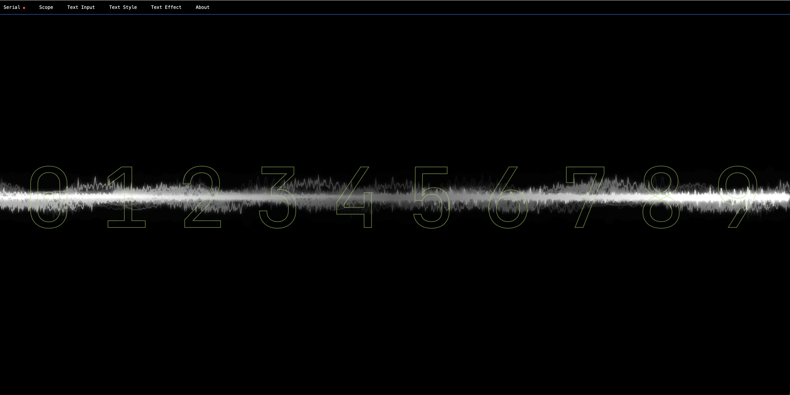

# Console (Visual) — v1.0

Console is a companion display for **Talko / Kraftor / Emy**.
It receives text over **Serial** (Web Serial) or **MIDI** information and displays it in real time, driven by the speech / text stream coming from those tools.

It can also use your **audio input** as a live source for visual effects and animations (Scope, Hydra, and other effects).

## Download / install

- Download **`Console.html`** (that’s all you need).
- `README.md` and `image.png` are only for documentation/screenshot.

## Run it

### Browser requirements

- **Serial** requires a browser that supports **Web Serial** (typically Chromium-based browsers like Chrome / Edge).

### Opening the HTML file

- You can open `Console.html` directly (double-click).
- If you have trouble running it locally (or Serial does not work), use the hosted version:
  - `https://deladriere.github.io/Console/Console.html`

## Connect Serial

1. Open **Serial → Connect Port**
2. Choose the device/port.
3. When connected, the red dot becomes **green**.

Incoming text/numbers are displayed live (Numbers modes / Words mode).

## VAX full sentences

Use **Text Input → String → Full sentence**, then **Serial → Connect Port**.
With the caption-enabled VAX firmware, MIDI triggers and Designer auditions
show the whole sentence. Console removes DECtalk commands and phoneme/pause
blocks, wraps the text, and ignores terminal prompts and diagnostic messages.
Existing text styles, effects, audio input, Numbers and Words modes remain available.

This displays a caption when speech is submitted; it does not track individual
word timing. Phoneme-only input needs a separate readable transcript and is
not converted back into words. USB MIDI can remain connected in VAX Designer
while Console uses serial; close other serial terminals first.

Caption frames use `RS + VAX: + native text + US + CRLF` (RS = byte 30,
US = byte 31). Only complete frames are displayed. An interrupted frame is
discarded when the next caption starts. Captions are best effort: busy or
disconnected serial, rapid replacements, or a FRAM listing may drop them.

## Audio input (microphone)

Some modes use the microphone as a live source:

- **Scope**: oscilloscope / frequency bars.
- **Hydra**: audio-reactive background patterns.

Your browser may ask for microphone permission when enabling these features.

## Keyboard shortcuts

- **Space**: hide/show the top menu bar
- **D**: toggle developer mode (shows extra menus)

