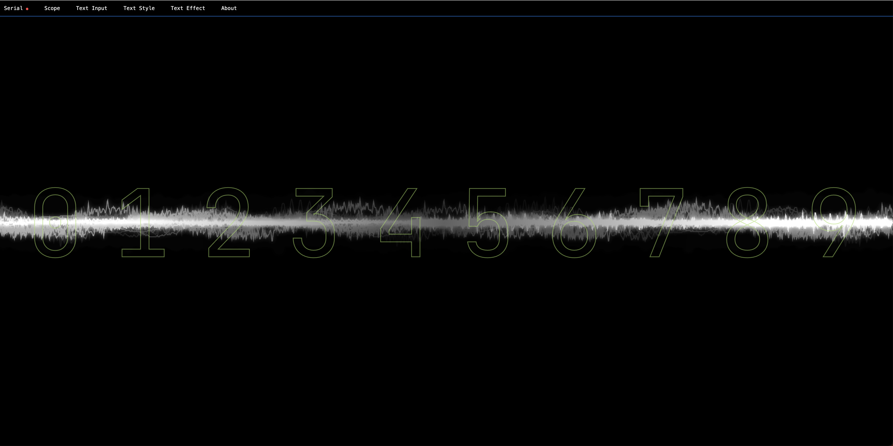

# Console (Visual) — v1.0



Console is a companion display for **Talko / Kraftor / Emy**.
It receives text over **Serial** (Web Serial) or **MIDI** information and displays it in real time, driven by the speech / text stream coming from those tools.

It can also use your **audio input** as a live source for visual effects and animations (Scope, Hydra, and other effects).

## Download / install

- Download **`Console.html`** (that’s all you need).
- `README.md` and `image.png` are only for documentation/screenshot.

## Run it

### Browser requirements

- **Serial** requires a browser that supports **Web Serial** (typically Chromium-based browsers like Chrome / Edge).


### Opening the HTML file

- You can open `Console.html` directly (double-click).
- If you have trouble running it locally (or Serial does not work), use the hosted version:
  - `https://deladriere.github.io/Console/Console.html`


## Connect Serial

1. Open **Serial → Connect Port**
2. Choose the device/port.
3. When connected, the red dot becomes **green**.

Incoming text/numbers are displayed live (Numbers modes / Words mode).

## VAX full sentences

Use **Text Input → String → Full sentence**, then **Serial → Connect Port**.
With the caption-enabled VAX firmware, MIDI triggers and Designer auditions
show the whole sentence. Console removes DECtalk commands and phoneme/pause
blocks, wraps the text, and ignores terminal prompts and diagnostic messages.
Existing text styles, effects, audio input, Numbers and Words modes remain available.

This displays a caption when speech is submitted; it does not track individual
word timing. Phoneme-only input needs a separate readable transcript and is
not converted back into words. USB MIDI can remain connected in VAX Designer
while Console uses serial; close other serial terminals first.

Caption frames use `RS + VAX: + native text + US + CRLF` (RS = byte 30,
US = byte 31). Only complete frames are displayed. An interrupted frame is
discarded when the next caption starts. Captions are best effort: busy or
disconnected serial, rapid replacements, or a FRAM listing may drop them.

### Word slicing

Choose **Text Input → String → Word slicing** to split a complete VAX caption
into words and display them one at a time. The first word appears immediately;
the last word stays on screen. A new caption replaces the running sequence.
Selecting the mode also slices the latest received caption, so you can switch
between the full sentence and sliced words without triggering VAX again.

The pace comes from the last DECtalk `[:ra ...]` or `[:rate ...]` command in the
caption (150 words/minute if absent, within 75-600). This is an approximate
display pace; it does not follow audio or account for individual word durations
and pauses. Disconnecting, hiding text or changing modes stops the sequence.
The existing **Words → Pulse / Zoom-in** modes still display incoming words
directly and do not slice sentences. No firmware change is needed.

Run `node tests/sentence_test.cjs` to check captions and word slicing.

## Talko S.A.M. lip sync

1. Enable **3D Head**, or press **D** and enable **2D Mouth**.
2. In the same menu, choose **Phoneme model → S.A.M.**
3. Use **Serial → Connect Port** and choose the Talko USB port.
4. On Talko, use **bank 7** for vowels and diphthongs or **bank 8** for
   consonants. Turn **SOUND** and press **GATE** to try each sound.
   **Bank 3** (single words) is a quick way to try a phoneme sequence.

Talko S.A.M. 0.6 sends phoneme changes as speech plays in all banks, along
with a pause at the end or on gate cutoff. The head holds its current shape
during an ERROR stutter. Choose **Text Input → Words** to display the spoken
labels alongside the mouth. With 0.5, individual phoneme labels from banks 7
and 8 give a brief mouth preview. Use 0.6 for continuous lip sync.

Console requests the stream with `RS + SAM + US`. Speech events use
`RS + SAM: + phoneme code + US`, with `-` for silence. Console routes those
events to the selected mouth model and keeps the plain labels available for
text display. Close any other serial monitor before connecting Console.

## Talko Monk vowel display

1. Enable **3D Head**, or press **D** and enable **2D Mouth**.
2. Choose **Phoneme model → Talko Monk** in that menu.
3. Use **Serial → Connect Port** and select Talko's USB port.
4. Play a note and turn SOUND, or hold ERROR to follow its vowel movements.

The Talko Monk model offers its five vowel labels in SOUND order:
**UW** (oo), **OH** (oh), **AA** (ah), **EH** (eh), **IY** (ee), plus
**-** for silence. Its preview and demo use those six mouth shapes.
**Text Input → Words** can show the labels alongside the mouth.

The model uses the existing framed vowel stream internally. A sustained
vowel holds the mouth open until another vowel or silence arrives. The
selected model is shared by 2D Mouth and 3D Head and saved for the next visit.
Close other serial monitors before connecting Console.

## Audio input (microphone)

Some modes use the microphone as a live source:

- **Scope**: oscilloscope / frequency bars.
- **Hydra**: audio-reactive background patterns.

Your browser may ask for microphone permission when enabling these features.

## Keyboard shortcuts

- **Space**: toggle fullscreen when 2D Mouth or 3D Head is active; otherwise hide/show the top menu bar
- **Escape**: exit fullscreen
- **D**: toggle developer mode (shows extra menus: 2D Mouth, MIDI, Hydra, …)

**Help** is always available under **About → Help**.


## Experimental 2D Mouth (developer mode)

Press **D** to reveal **2D Mouth**, then select **Enable 2D Mouth**.
This migrates the former `Visual/Robovox_mouth` app into Console, sharing
**Serial → Connect Port** at 115200 baud; it does not open a second port.

- **Renderer:** new animated vector robot, or original bitmap mouth images.
- **Phoneme model:** Votrax SC-01, Votrax SC-02, S.A.M. or Talko Monk.
- **View:** full head or mouth only. Bitmap mode retains all four original faces.
- **Show phoneme / mapping:** code, IPA, viseme ID and input source.
- **Space:** enter / exit actual browser fullscreen for the active vector or bitmap
  display. The head grows to fit the screen, the debug label is hidden, and Scope
  stays visible behind it. **Escape** exits fullscreen; disabling Mouth or
  developer mode also exits.
  Text fields, selects, buttons and modified keyboard shortcuts retain their
  normal keyboard behavior. Exiting restores the previous menu visibility.
- **Preview / test:** choose a phoneme, type an exact code, or play the silent demo.
  An incoming valid serial phoneme stops the demo and takes over immediately.

In a Votrax model, serial input expects one exact Votrax label per line (for example `M`, `AH`,
`SCH`, `PA` for SC-02; `PA0` for SC-01). Split serial chunks are buffered.
Unknown lines and VAX caption frames do not animate the mouth. This works
even when Text Input display is off or is using Full sentence / Word slicing.
No audio analysis, text-to-phoneme conversion, or VAX lip sync is performed.
Animation follows received events; precise alignment with hardware audio is
not guaranteed. Send pause/silence explicitly to close the mouth.

The display starts disabled on every load. Renderer, model, view, face and debug
preferences are retained. Leaving developer mode hides the display and stops
the demo; disconnecting or hiding the page resets to silence. The SVG eyes blink
and mouths interpolate; reduced-motion preferences disable those animations.

`Console.html` remains a single-file app: the 22 original PNG mouths and four
face bitmaps are embedded without conversion. Its existing external fonts and
Hydra dependency are unchanged. Viseme images and mapping provenance are inherited
from Robomouth; see [Microsoft viseme documentation](https://learn.microsoft.com/en-us/azure/ai-services/speech-service/how-to-speech-synthesis-viseme).
This migration does not establish additional rights to the original bitmap assets.

Run `node tests/mouth_test.cjs` for mapping preservation, embedded asset integrity,
stream framing and lifecycle regression checks, and `node tests/sentence_test.cjs`
for the existing captions / word slicing behavior.

## Experimental 3D Head

Open **3D Head → Enable 3D Head** (always in the main menu; no developer mode needed).
**Style → Wireframe / Solid (shaded)** chooses between blue mesh lines and a
smoothly shaded human face. Both modes use the same ready-made MakeHuman hm08
head with its original anatomical proportions and 22 supplied mouth targets.
They share Console's SC-01, SC-02, S.A.M. and Talko Monk phoneme mappings, serial input and silent demo.
The former procedural head has been replaced. Original vector and bitmap modes
remain in **2D Mouth** (developer mode); only one head renderer is active at a time.

- Drag the head, use arrow keys while it is focused, or adjust **View angle**.
- **Head size** scales the display from 50% to 160% (Reset view returns to 100%).
- **Face width** broadens the head from 100% to 140% along its own X axis in
  both styles and at every mesh detail level. It follows rotation and facial
  animation; solid lighting follows the wider surface. The preference is saved,
  and Reset view retains the chosen width. 100% restores the original proportions.
- **Mesh detail** has five settings for both 3D styles: 100% uses the original
  4,786 polygons; 75%, 50%, 25% and 10% use 3,500, 2,400, 1,500 and 1,249 polygons.
  Move toward **Robotic** for larger, more angular polygons. Reduced solid heads
  use flat polygon normals; 100% retains the original smooth shading and wire grid.
  The preference is saved across reloads; Reset view retains the selected detail.
- Choose **Wire colour** in Wireframe style or **Head colour** in Solid style.
  The two colours are saved independently. Head colour changes the shaded surface;
  eyes, teeth and tongue retain their original materials.
- Enable **Auto rotate**, or **Reset view**.
- **Mouth close-up** zooms into the source mesh's lips and jaw.
- The head canvas is transparent outside the mesh, so Scope and Hydra stay visible
  around it. The face itself is an opaque silhouette, so the waveform does not cut
  through the wires. Fullscreen keeps Scope/Hydra running behind the head.
- **Enable 3D Head** uses the same toggle switch style as Scope / Hydra.
- **Space** toggles true fullscreen (document-level, so Scope stays visible);
  **Escape** exits. Input controls retain their normal keyboard behavior.
  Click the head after editing a field to use Space.
- Both 3D styles blink naturally at irregular 3–7 second intervals. Eyelid movement
  blends independently with speech, with quick closure and gentler reopening.
- Reduced-motion preferences disable automatic blinks, auto rotation and mouth interpolation.
  Animation stops when the page or renderer is hidden.

The embedded model contains 4,858 vertices, 4,786 faces and all 22 CC0 viseme
shapes. Original quads provide the wire lines without triangulation diagonals.
WebGL renders depth-tested hidden lines or smooth shaded surfaces. No new library,
model download or network request is needed at runtime; `Console.html` remains
self-contained for all head assets. A WebGL-capable browser is required for 3D.
The existing hardware speech timing limitations still apply.

Reduced meshes use baked edge collapses referencing original source vertices, so
the same 22 mouth targets and independent eyelid targets animate every level.
The source model and its checksum are unchanged. Lip landmarks, fast-moving
eyelid rims, symmetry seams and open boundaries are protected during reduction.
The 10% minimum gives a strongly faceted head; 50% is a useful first comparison.
Regenerate the embedded reduced topologies with
`python3 tools/build_head_detail.py Console.html` after changing the source model.
No simplification runs during playback.

Run `node tests/head3d_test.cjs` to verify the actual mesh, normals, morph targets,
source metadata, embedded asset integrity and interpolation. Existing phoneme /
bitmap and VAX caption tests remain `tests/mouth_test.cjs` and
`tests/sentence_test.cjs`.
Run `node tests/head_detail_test.cjs` for reduced topology, exact boundaries,
connected components and source-exact facial animation at every detail level.

## 3D Head sources and license

These sources are also available in **About → 3D Head sources**.

- **Head:** MakeHuman Community, hm08 base mesh.
  [Pinned mesh source](https://raw.githubusercontent.com/makehumancommunity/makehuman/a8bc2d54ff0ac92e78ff71431b1023eda42bf482/makehuman/data/3dobjs/base.obj),
  revision `a8bc2d54ff0ac92e78ff71431b1023eda42bf482`.
- **22 mouth shapes:** [Visemes 01](https://static.makehumancommunity.org/assets/assetpacks/visemes01.html)
  by **Mika Suominen**. Each target is explicitly marked CC0 in the pack metadata.
  [Original target pack](https://files.makehumancommunity.org/functional/visemes01.zip).
- **Eyelid blinks:** left/right blink targets from [Faceunits 01](https://static.makehumancommunity.org/assets/assetpacks/faceunits01.html)
  by **Mika Suominen**, explicitly CC0 in the pack metadata.
  [Original target pack](https://files.makehumancommunity.org/functional/faceunits01.zip).
- **Asset license:** [CC0 1.0 Universal](https://static.makehumancommunity.org/about/license.html).
  The mesh, viseme and eyelid data may be used, modified and redistributed, including
  in public GitHub repositories. The full upstream legal text is in
  `assets/head3d/CC0-1.0.txt`. Asset URLs, author names, revision and SHA-256
  checksums are in `assets/head3d/provenance.json` and the embedded model metadata.
- **Adaptation:** head/neck extraction, original vertex ID remapping, translation
  and a clean display cut at the neck. Facial proportions and source mouth targets
  are preserved. The renderer, loader, solid shading and viseme interpolation are
  Console code. No MakeHuman application code is incorporated; its application
  software license is separate from the CC0 asset license.

To reproduce the embedded data, download the three checksum-pinned assets above and run:

```sh
python3 tools/build_head_asset.py --base base.obj --visemes visemes01.zip --faceunits faceunits01.zip --output head.json
```

The source and license statements here cover the replacement 3D assets. Existing
bitmap assets retain their previously documented provenance.
